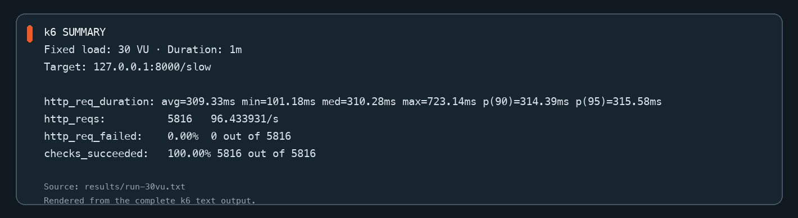
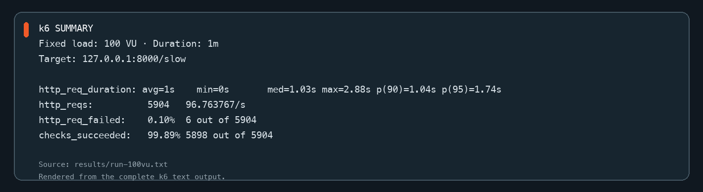

# k6-аар гүйцэтгэл хэмжих лаборатори

**Хичээл:** F.CSA313 — Программ хангамжийн чанарын баталгаа ба тест (2026)  
**Хэмжилтийн огноо:** 2026-11-21  
**k6 хувилбар:** `k6 v2.4.0 (commit/dd9395906d, go1.26.11, darwin/arm64)`

## Туршилтын орчин

Ачааллын тестийг локал сервер (`http://127.0.0.1:8000/slow`) дээр гүйцэтгэв. `local_server.py` нь хүсэлт бүрд 100 мс хүлээлт үүсгэдэг бөгөөд зэрэгцээ 10 worker slot-оор хязгаарлагдсан тул илүү гарсан хүсэлтүүд дараалалд хүлээгдэнэ.

Серверийг асаах болон тестүүдийг ажиллуулах командууд:

```sh
python3 local_server.py
k6 run --vus 5 --duration 1m script.js | tee results/run-05vu.txt
k6 run --vus 30 --duration 1m script.js | tee results/run-30vu.txt
k6 run --vus 100 --duration 1m script.js | tee results/run-100vu.txt
k6 run stages.js | tee results/run-stages.txt
P95_LIMIT_MS=160 k6 run thresholds.js | tee results/threshold-pass.txt
P95_LIMIT_MS=50 k6 run thresholds.js | tee results/threshold-fail.txt
```

## Суурь хэмжилт (5 VU Baseline)

`script.js`-ийг 5 VU, 1 минутын хугацаатай ажиллуулахад суурь **p95 latency нь 106.38 ms** гарсан бөгөөд үүнийг SLO босго тогтооход ашиглав.

## Ачааллын хэмжилт (5 / 30 / 100 VU)

| VU | p90 latency | p95 latency | Throughput (`http_reqs`) | Error rate (`http_req_failed`) |
|---:|---:|---:|---:|---:|
| 5 | 106.17 ms | 106.38 ms | 47.672489 req/s | 0.00% (0/2863) |
| 30 | 314.39 ms | 315.58 ms | 96.433931 req/s | 0.00% (0/5816) |
| 100 | 1.04 s | 1.74 s | 96.763767 req/s | 0.10% (6/5904) |

### Stages туршилт

5 VU-ээс 30, улмаар 100 VU хүртэл шатлан өсгөж буулгасан (`stages.js`) туршилтын нэгтгэсэн үр дүн: p90 **871.19 ms**, p95 **958.65 ms**, throughput **78.665074 req/s**, error rate **0.00% (0/11805)** (`results/run-stages.txt`).

## SLO Thresholds (PASS / FAIL)

Baseline p95 (`106.38 ms`)-ийг 1.5 дахин өсгөж (`106.38 × 1.5 = 159.57 ms`) тоймлон **p95 < 160 ms**, харин алдааны хувийг **1%-аас бага (`rate<0.01`)** байхаар SLO тогтоов.

- **PASS (`P95_LIMIT_MS=160`):** p95 **106.24 ms**, error rate **0.00%** болж хоёр шалгуурыг давсан (`results/threshold-pass.txt`).
- **FAIL (`P95_LIMIT_MS=50`):** Босгыг зориудаар хатуу болгоход p95 **106.4 ms** гарч `p(95)<50` нөхцөлийг зөрчсөн тул тест FAIL төлөвтэй дууссан (`results/threshold-fail.txt`).

## Дүгнэлт

5 VU ачаалалтай үед локал сервер тогтвортой ажиллаж, p95 latency 106.38 ms, throughput 47.67 req/s гарсан. Хэрэглэгчийн тоог 30 VU болгоход серверийн 10 worker бүрэн ачаалагдаж throughput 96.43 req/s хүрсэн ч хүсэлтүүд дараалалд хүлээгдсэнээс p95 latency 315.58 ms болж өссөн. Харин 100 VU үед throughput 96.76 req/s орчимд тогтож цааш өсөөгүй бол p95 latency 1.74 s болж огцом удааширсан. Эндээс зэрэгцээ хэрэглэгчийн тоо серверийн боловсруулах хязгаараас давахад throughput нэмэгдэхээ больж, харин хүлээлгийн хугацаа огцом уртасдаг нь харагдлаа. Мөн 100 VU үед нийт 5904 хүсэлтээс 6 нь амжилтгүй болж error rate 0.10% гарсан нь өндөр ачааллын үед зарим хүсэлт амжилтгүй болж байгааг харуулж байна (`results/run-100vu.txt`). Stages туршилтаар ачааллыг 5-аас 100 VU хүртэл шатлан өсгөж буулгахад нэгтгэсэн p95 latency 958.65 ms, throughput 78.67 req/s гарсан. Суурь 5 VU хэмжилтэд (106.38 ms) тулгуурлан p95 < 160 ms, алдаа < 1% гэсэн SLO шалгуур тавихад хэвийн ачааллаар PASS гарсан. Харин босгыг p95 < 50 ms болгож хатууруулахад p95 106.4 ms гарч k6 автоматаар FAIL төлөв буцаасан.

## Дэлгэцийн зургууд ба үр дүнгийн файлууд

Бүх тестийн бүрэн текст гаралтууд `results/` хавтаст, харин терминалын хураангуй дэлгэцийн зургууд `screenshots/` хавтаст хадгалагдсан.

### 5 VU Summary


### 30 VU Summary


### 100 VU Summary

